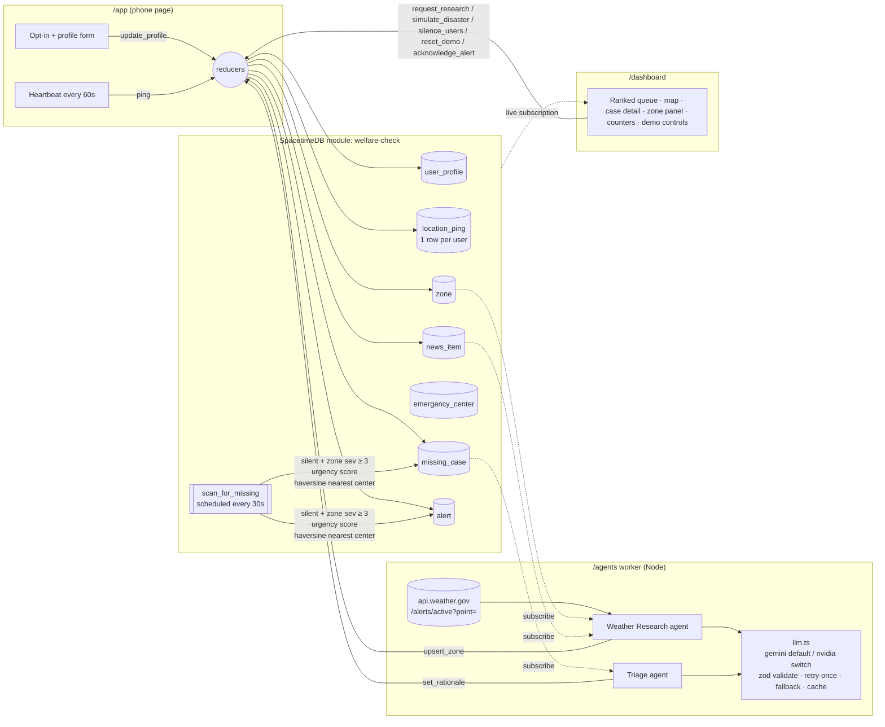

# Welfare Check — Architecture

> Concept prototype. All people, places, centers and news items are **synthetic**.

## One sentence

The system finds people who stopped sending their location inside a disaster zone, ranks them by
urgency, and tells the nearest emergency center.

## Components

| Package    | What it is                                                                 | Runs where                     |
|------------|----------------------------------------------------------------------------|--------------------------------|
| `/module`  | SpacetimeDB module (TypeScript). Tables, reducers, scheduled scan, scoring. | Inside SpacetimeDB             |
| `/agents`  | Node/TS worker. Weather Research and Triage agents. All LLM + web calls live here. | Your laptop / any Node host |
| `/web`     | Vite + React + Leaflet. Routes `/app`, `/dashboard`.                        | Browser                         |
| `/seed`    | Seed + inspection script. Writes the synthetic dataset to JSON and loads it via `reset_demo`. | CLI |

The module never calls outside web APIs. Every model call and every HTTP request (NWS, Gemini,
NVIDIA) happens in `/agents`, which connects to SpacetimeDB as an ordinary client.

## Diagram



## Data flow

1. **Heartbeat.** `/app` asks for opt-in, saves a small profile (`update_profile`), then calls `ping`
   every 60 seconds with `navigator.geolocation`. `location_ping` is keyed by identity, so each ping
   overwrites the previous row. Opting out deletes the row.
2. **Hazard rating.** The Weather Research agent watches `zone` rows. It runs on a timer and whenever a
   zone's `researchStatus` is `requested` (dashboard button → `request_research`). It fetches NWS active
   alerts for the zone center, reads the zone's `news_item` rows, asks the model for
   `{hazard, severity 1–5, confidence 0–1, summary, evidence[]}`, validates with zod, and writes the
   result with `upsert_zone` tagged `source = llm | fallback`.
3. **Scan.** `scan_for_missing` is a scheduled reducer (schedule table `scan_schedule`, 30 s interval).
   For every zone with severity ≥ 3 it finds users inside the radius whose last ping is older than
   `SILENCE_THRESHOLD_MIN`. For each one it opens (or refreshes) a `missing_case`, computes the urgency
   score **inside the reducer**, picks the nearest `emergency_center` with haversine, and writes an
   `alert` row. Cases close automatically (`resolved`) when the person pings again.
4. **Triage.** The Triage agent watches `missing_case` rows with an empty rationale and writes one
   sentence per case (`set_rationale`). It batches up to 10 cases per model call. It never changes the score.
5. **Dashboard.** `/dashboard` subscribes to every public table and re-renders on every row change.

## Rules the code enforces

- **Code decides numbers.** Urgency score, silent minutes, distances and nearest center are
  computed in TypeScript (`module/src/logic.ts`). The model only reads and writes text
  (plus the hazard rating, which the spec assigns to the Weather agent).
- **Wording.** Alerts say "welfare check", never "confirmed emergency". A dead battery and lost signal
  look identical, and the UI says so.
- **Provenance.** Every agent result carries `source = "llm" | "fallback"`. Fallbacks are never shown as
  live model output.

## Urgency score

```
score = 40 * (severity / 5)
      + 30 * (min(silent_minutes, 120) / 120)
      + 30 * vulnerability_flag
```

Weights live in one constant, `URGENCY_WEIGHTS` in `module/src/logic.ts`. The dashboard labels them as a
**tunable, unvalidated** model.

## Synthetic users and heartbeats

The 200 seeded users have no phones, so the scheduled scan refreshes the ping timestamp of every
synthetic user whose `simSilent` flag is false. That simulates a live phone. Seeded "stale" users and users
picked by `silence_users` have `simSilent = true`, so their last ping stops moving. Real `/app` users are
never touched by this step.

## Stretch goals (not built, not blocked)

Offline queueing, service workers, SMS fallback and Bluetooth mesh. `ping` takes an explicit
`accuracy` and the heartbeat sender is isolated in `web/src/app/heartbeat.ts`, so a queued/offline sender
can replace it later without schema changes.
